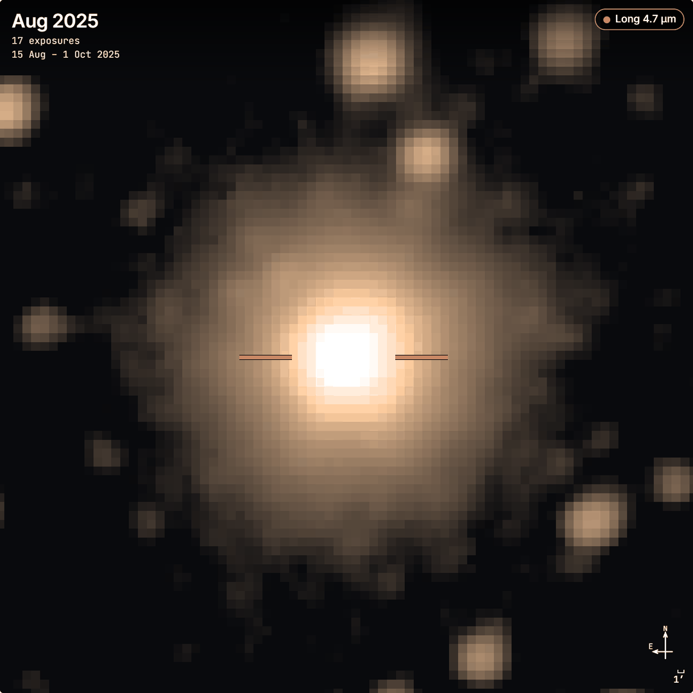
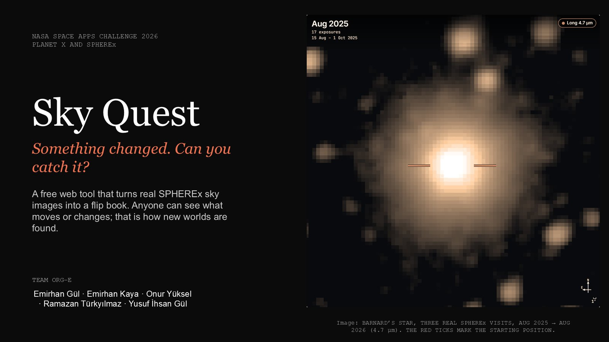

# Sky Quest

A free web tool that turns real SPHEREx sky images into a flip book, so anyone can catch what moves or changes over time.

NASA Space Apps Challenge 2026 · Challenge: [Planet X and SPHEREx](https://www.spaceappschallenge.org/2026/challenges/planet-x-and-spherex/) · Team ORG-E:
Emirhan Gül, Emirhan Kaya, Onur Yüksel, Ramazan Türkyılmaz, Yusuf İhsan Gül

## Presentation

Click the slide to see the whole deck on one page (English, with a Turkish copy).

PowerPoint files: [English](presentation/SkyQuest_SpaceApps2026_EN.pptx) · [Türkçe](presentation/SkyQuest_SpaceApps2026_TR.pptx)

## What is in this repository

| Folder | Contents |
| --- | --- |
| [`frontend/`](frontend/README.md) | The web app (React, Vite): five practice cases and free exploration of any coordinates |
| [`backend/`](backend/README.md) | FastAPI service between the data modules and the web app |
| [`imaging/`](imaging/README.md) | Turns cached SPHEREx cutouts into co-added frames and numeric patches |
| [`pipeline/`](pipeline/README.md) | Downloads SPHEREx cutouts from NASA/IPAC IRSA and keeps a local cache |
| [`docs/`](docs/) | Design notes and references (mostly in Turkish) |
| [`presentation/`](presentation/README.md) | The seven-slide deck, English and Turkish |

To run the app, start with [frontend/README.md](frontend/README.md) and [backend/README.md](backend/README.md).

## Data

Public data only: SPHEREx images from NASA/IPAC IRSA (and its open copy on AWS), Gaia DR3 (ESA), CatWISE2020,
and SIMBAD (CDS) for object names.

## License

[MIT](LICENSE)
