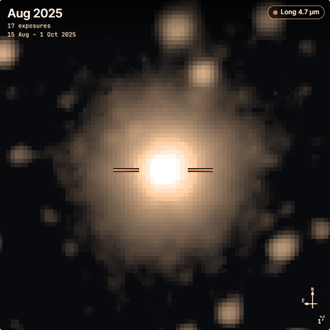
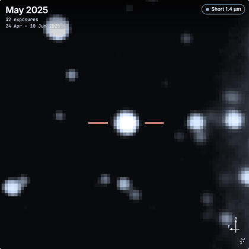
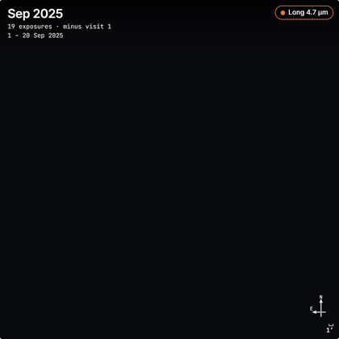
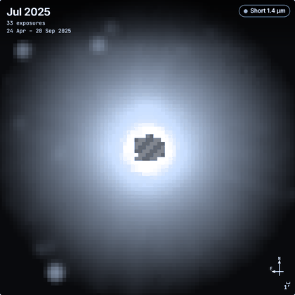
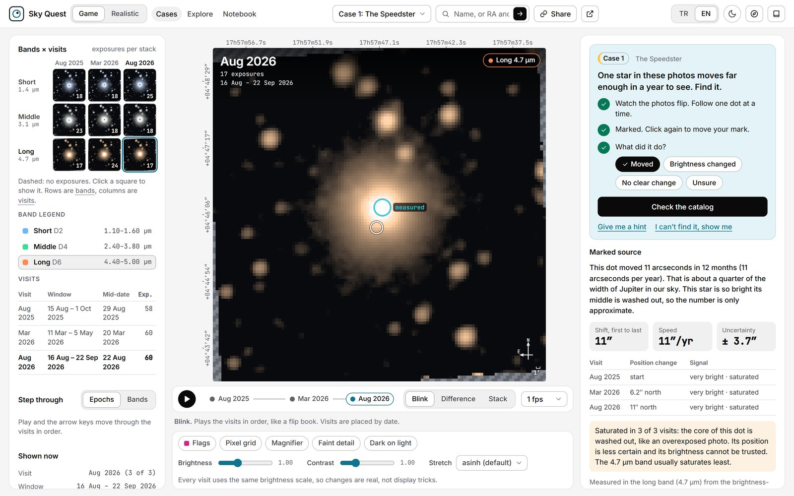
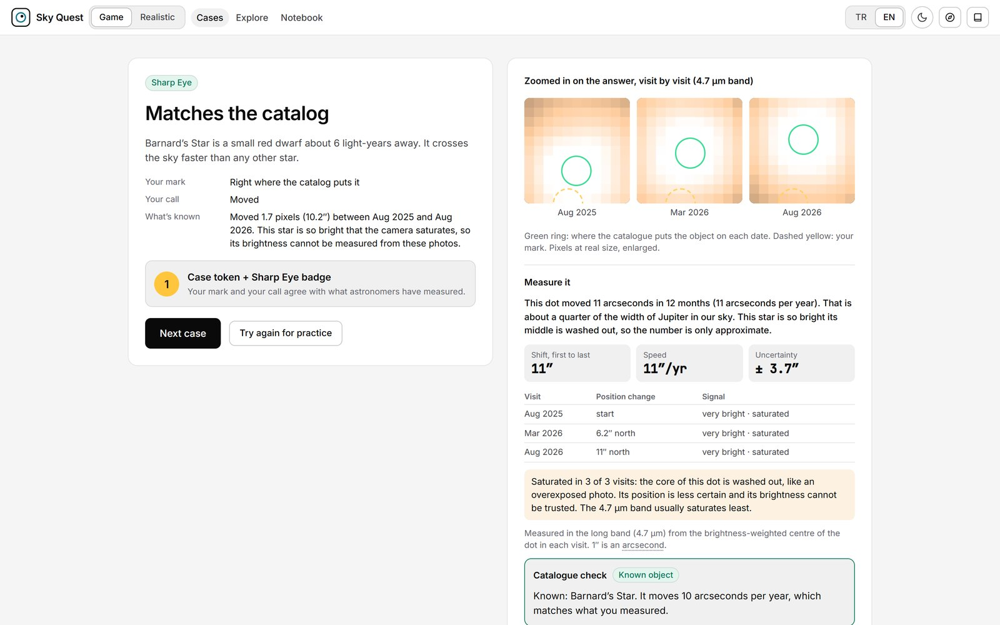
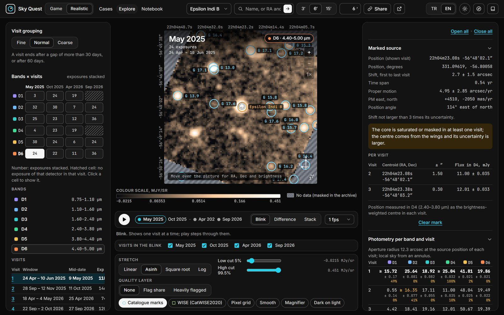

# Sky Quest

**NASA Space Apps Challenge 2026 · Planet X and SPHEREx**

A free web tool that turns real SPHEREx sky images into a flip book, 
so anyone can catch what moves or changes over time.

[See it in action](#see-it-in-action) · [Presentation](#presentation) · [Repository](#what-is-in-this-repository) · [Data](#data)

**Team ORG-E** · Emirhan Gül · Emirhan Kaya · Onur Yüksel · Ramazan Türkyılmaz · Yusuf İhsan Gül

---

## See it in action

Four of the five practice cases, recorded in the app from real SPHEREx visits. All five cases are the challenge's
test targets; the fifth, WISE 0855, compares bands instead of visits. Red ticks mark where the target started.

| Case 1 · The Speedster | Case 3 · The Twins |
| --- | --- |
|  |  |
| Barnard's Star at 4.7 µm, Aug 2025 to Aug 2026. It moves about 10″ north, away from the red ticks. | Epsilon Indi B at 1.4 µm, four visits from May 2025 to Sep 2026. It shifts by about one SPHEREx pixel (6.15″), so this case teaches the magnifier and pixel grid. |
| **Case 4 · The Flicker** | **Case 5 · The Pulse** |
|  |  |
| RW Aurigae at 4.7 µm in the Difference view: each visit minus the first. Teal means it was brighter before, so the star is fading. | R Draconis, a pulsating red giant, at 1.4 µm from Jul 2025 to Apr 2026. Its glow shrinks as it fades. |

### Screens

| Game mode: a practice case | After "Check the catalog" |
| --- | --- |
|  |  |

Realistic mode: all six detectors, Gaia DR3 positions at the visit date, and the measurement panel for Epsilon Indi B.

## Presentation

Click the slide to see the whole deck on one page (English, with a Turkish copy).

PowerPoint files: [English](presentation/SkyQuest_SpaceApps2026_EN.pptx) · [Türkçe](presentation/SkyQuest_SpaceApps2026_TR.pptx)

## What is in this repository

| Folder | Contents |
| --- | --- |
| [`frontend/`](frontend/README.md) | The web app (React, Vite): five practice cases and free exploration of any coordinates |
| [`backend/`](backend/README.md) | FastAPI service between the data modules and the web app |
| [`imaging/`](imaging/README.md) | Turns cached SPHEREx cutouts into co-added frames and numeric patches |
| [`pipeline/`](pipeline/README.md) | Downloads SPHEREx cutouts from NASA/IPAC IRSA and keeps a local cache |
| [`docs/`](docs/) | Design notes and references (mostly in Turkish) |
| [`presentation/`](presentation/README.md) | The seven-slide deck, English and Turkish |
| [`media/`](media/) | The banner, recordings and screenshots on this page |

To run the app, start with [frontend/README.md](frontend/README.md) and [backend/README.md](backend/README.md).

## Data

Public data only: SPHEREx images from NASA/IPAC IRSA (and its open copy on AWS), Gaia DR3 (ESA), CatWISE2020,
and SIMBAD (CDS) for object names.

## License

[MIT](LICENSE)
