# Sky Quest presentation

NASA Space Apps Challenge 2026 · Challenge: Planet X and SPHEREx · Team ORG-E

Seven slides. The English deck is the official one; the Turkish deck has the same content.

| | English | Türkçe |
| --- | --- | --- |
| PowerPoint | [SkyQuest_SpaceApps2026_EN.pptx](SkyQuest_SpaceApps2026_EN.pptx) | [SkyQuest_SpaceApps2026_TR.pptx](SkyQuest_SpaceApps2026_TR.pptx) |
| Cover animation | [barnard-blink.gif](barnard-blink.gif) | [barnard-blink-tr.gif](barnard-blink-tr.gif) |

GitHub cannot preview .pptx files, so every slide is shown below as an image.

The cover animation is a real recording from the app: Barnard's Star in three SPHEREx visits
(Aug 2025 to Aug 2026, 4.7 µm), moving away from the red ticks that mark where it started.

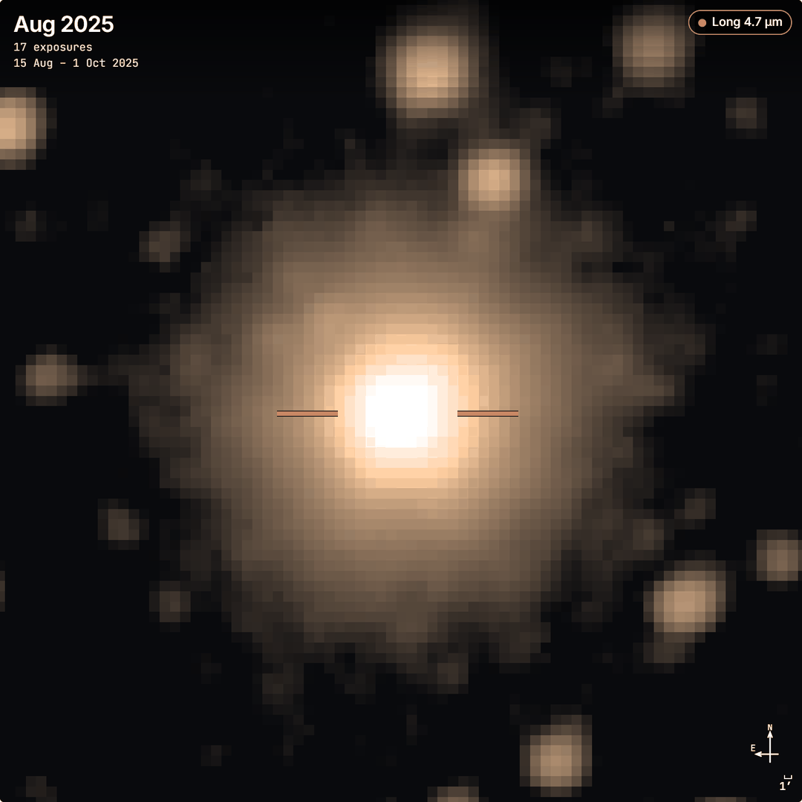

## Slides (English)

### 1. Sky Quest

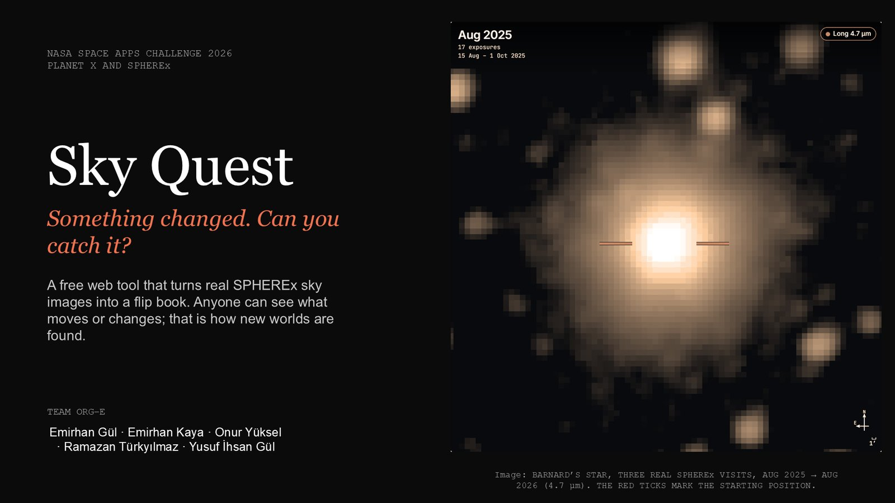

### 2. A moving dot can give away a hidden world

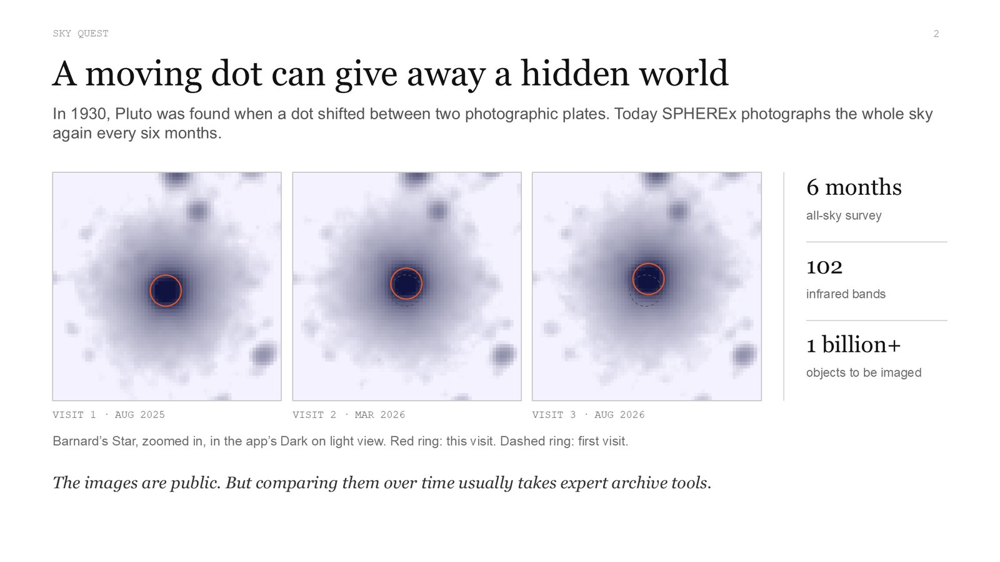

### 3. Four obstacles, four fixes

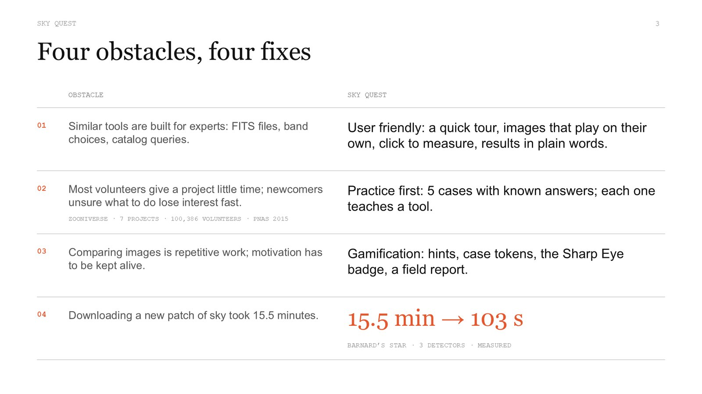

### 4. Open, watch, click; the site explains the rest

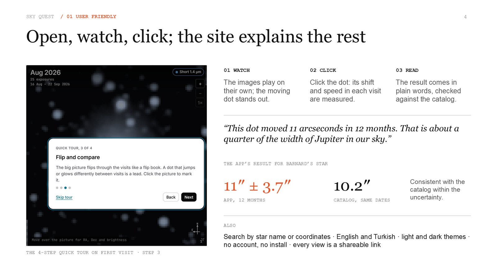

### 5. Practice first, then explore

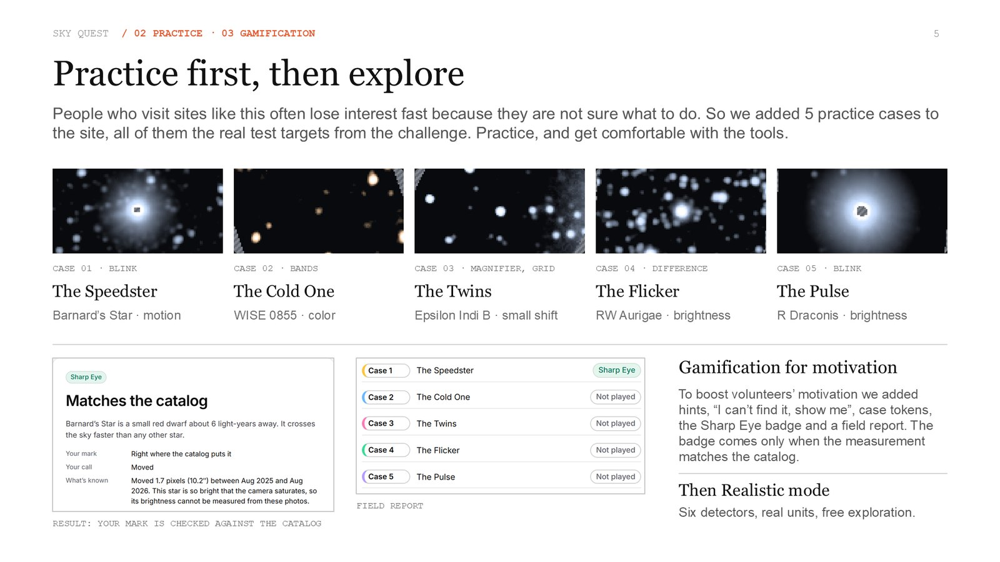

### 6. Real observations, shorter waits

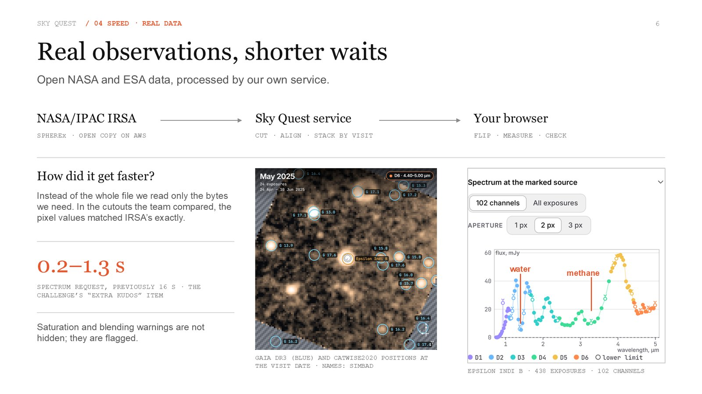

### 7. For anyone who is curious

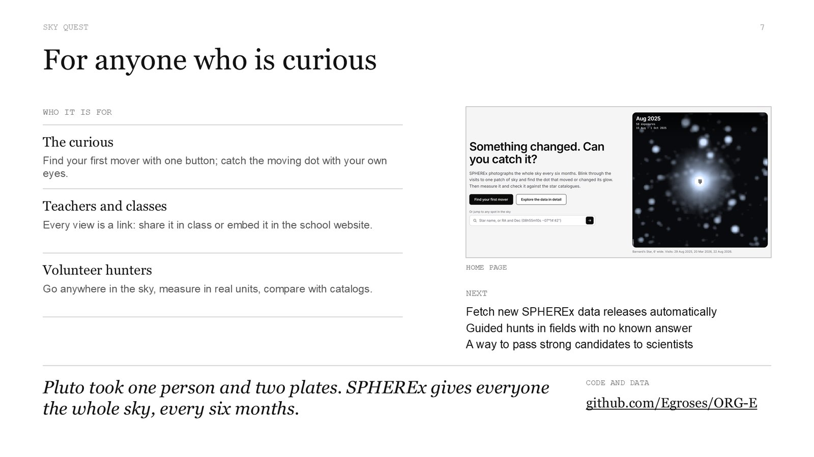

## Slaytlar (Türkçe)

Türkçe slaytları göster

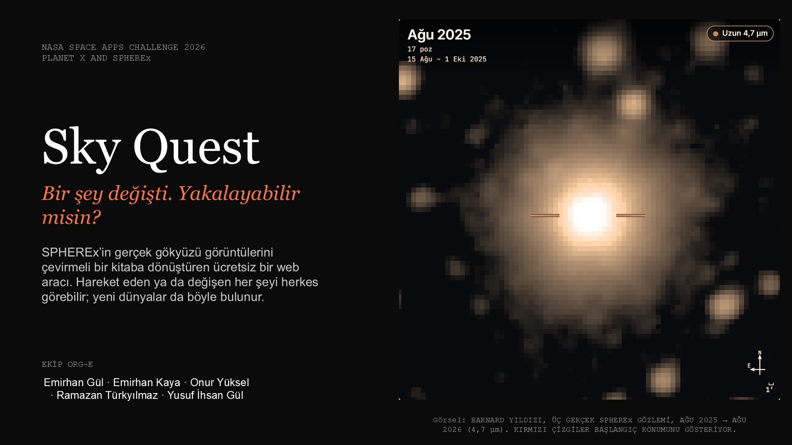

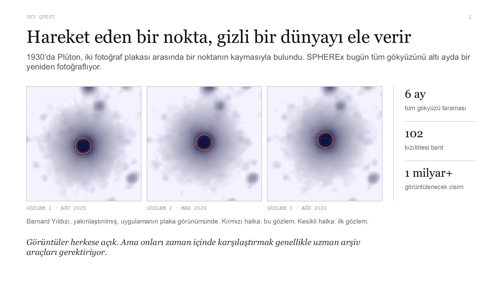

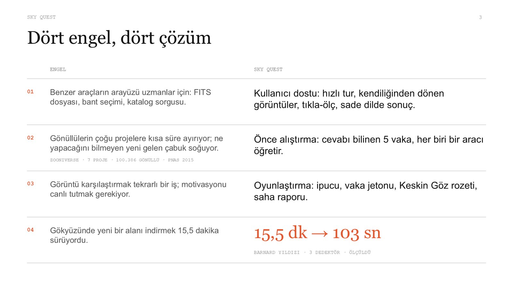

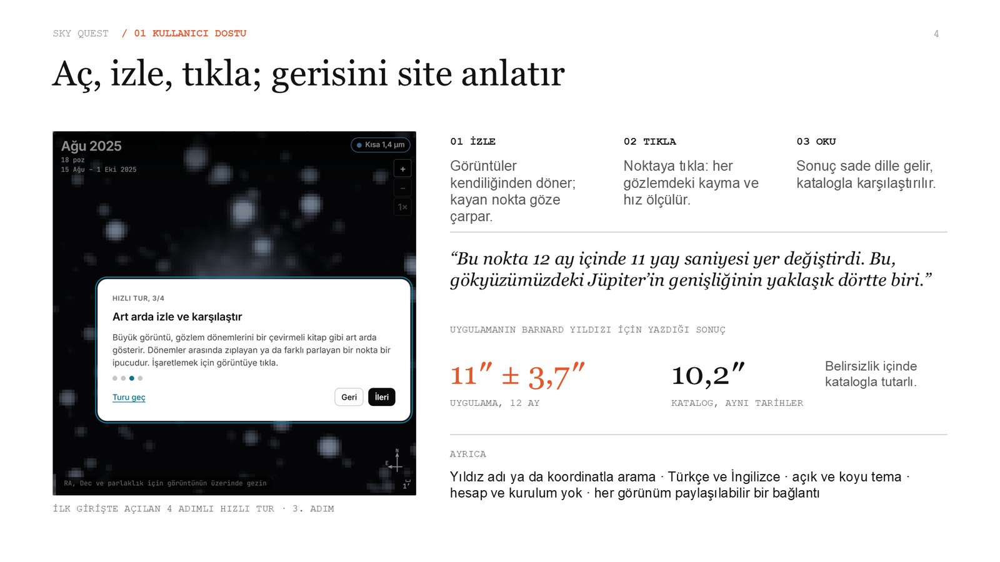

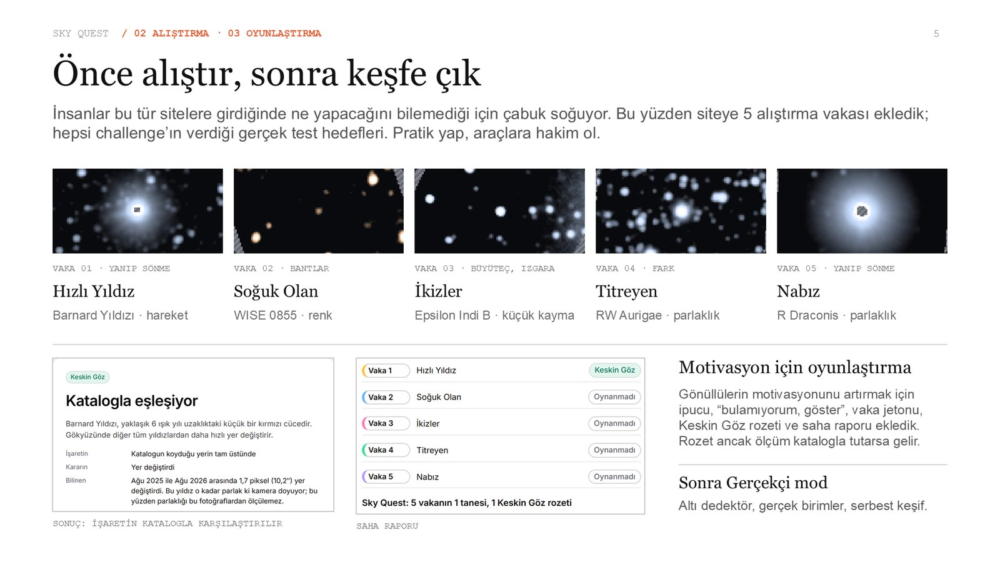

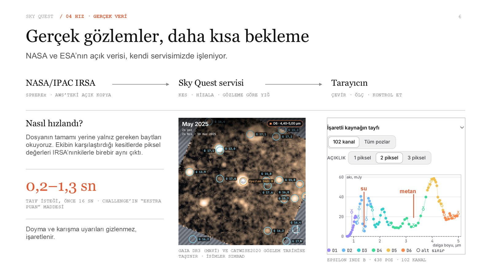

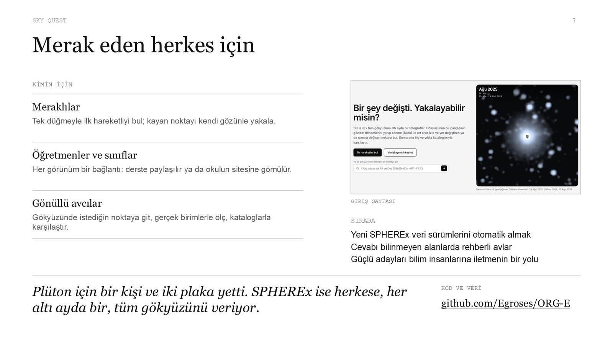

[Back to the project README](../README.md)
